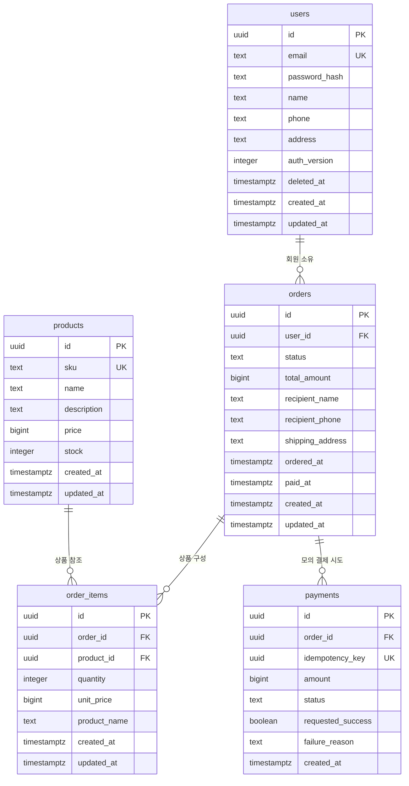

# STEP 1 — 쇼핑몰 ERD

## 관계의 근거

- users 1 : orders N — 회원은 장바구니와 여러 주문을 소유하며, 탈퇴 후에도 회원 행과 주문을 보존합니다.
- orders 1 : order_items N — 빈 장바구니는 상품이 0개일 수 있고, 확정 주문에는 상품이 1개 이상이어야 합니다.
- products 1 : order_items N — 같은 상품이 여러 회원의 장바구니와 주문에 포함될 수 있습니다.
- orders 1 : payments N — 미결제 주문은 기록이 없을 수 있고 실패 후 재시도 이력을 보존하되 성공은 1건으로 제한합니다.

## 상태와 처리 계약

1. 장바구니는 `cart`이며 회원당 최대 1개입니다. 항목의 단가/상품명은 표시용 임시 값이고 총액은 0으로 유지합니다. 장바구니 API가 현재 상품 정보를 함께 조회합니다.
2. 주문 생성 시 소유권과 탈퇴 여부를 확인하고 주문/상품 행을 잠근 트랜잭션에서 재고를 확인합니다. 현재 가격과 상품명을 항목에 다시 저장하고 합계 및 배송지를 확정하여 `pending`으로 바꿉니다. 빈 주문은 허용하지 않습니다.
3. 결제 시 주문 행과 상품 행을 일정한 ID 순서로 잠그고 재고를 다시 확인합니다. 성공 결제 저장, 재고 차감, `paid` 전환은 하나의 트랜잭션으로 처리합니다. 주문 단계에서는 재고를 예약하지 않습니다.
4. 모의 결제 실패 시 실패 결과만 저장하고 주문은 `pending`으로 유지합니다. 동일 요청 키 재전송은 기존 결과를 반환하고, 새 재시도에는 새 키를 사용합니다. 같은 키의 주문/금액이 다르면 요청을 거절합니다.
5. `pending`/`paid` 항목과 확정 총액은 수정하지 않습니다. 구매내역은 `paid` 주문만 보여줍니다. 결제 성공 후 상품목록으로 돌아갑니다.

DB 테이블은 FK, 금액/수량 범위, 상태별 필수 값, 장바구니/성공 결제 중복을 제한합니다. 항목 합계=주문 총액=결제 금액, 주문별 소유권, 허용 상태 전이, 최소 항목 수 및 동시 재고 처리는 STEP 3의 `sql/step3_functions.sql`에서 처리합니다. schema.sql에 이어 추가 SQL도 적용해야 합니다.

## 인증·보안 결정

- 인증은 JWT를 HttpOnly 쿠키에 담는 방식으로 선택합니다. FastAPI의 자체 회원 DB를 사용하면서 브라우저 JavaScript가 토큰을 읽지 못하게 할 수 있기 때문입니다.
- STEP 2에서 만료 시간, 운영 환경 Secure, SameSite 및 변경 요청의 CSRF 방어를 적용합니다. JWT의 회원 ID와 `auth_version`을 DB와 대조하고 탈퇴·로그아웃·비밀번호 변경 시 버전을 증가시켜 기존 토큰을 무효화합니다.
- 비밀번호 원문은 저장하지 않고 bcrypt 해시만 `password_hash`에 저장합니다. Supabase Auth와 자체 users를 혼용하지 않습니다.
- RLS를 활성화하고 공개 역할의 테이블 권한을 제거합니다. 상품 공개 조회도 FastAPI를 거칩니다. service_role 키는 서버 환경변수에서만 사용하며 서버가 회원별 접근 권한을 검증합니다.
- FK는 모두 `ON DELETE RESTRICT`입니다. 회원 탈퇴는 `deleted_at` 설정으로 처리하고 사용자/주문/결제 행을 삭제하지 않습니다. 빈 장바구니 정리가 필요하면 해당 항목부터 삭제합니다.

## 적용 방법

Supabase Dashboard → 대상 프로젝트 → SQL Editor → New query에서 `sql/schema.sql` 전체를 붙여넣고 Run을 누릅니다. 성공 후 새 쿼리에서 `sql/seed.sql` 전체를 실행합니다. Table Editor의 ch2 스키마에서 5개 테이블과 products의 5개 상품을 확인합니다.

기존 동명 테이블이 있는 DB에는 적용하지 않습니다. 스키마는 신규 DB용이며 전체 트랜잭션으로 실행되어 중간 오류 시 롤백됩니다. seed는 재실행해도 기존 상품을 덮어쓰지 않습니다.

가정: 통화는 원화(KRW) 정수이고 배송비·세금·할인 계산은 없습니다.

가정: 회원가입에 이메일·비밀번호·이름·연락처·주소를 입력하며, 탈퇴한 이메일은 재사용하지 않습니다.

가정: 배송지는 주문 시 회원정보에서 복사하며, 이후 회원정보 변경이 과거 주문에 영향을 주지 않습니다.

가정: 바로 결제는 선택 상품만으로 별도 pending 주문을 만들며 기존 장바구니는 유지합니다.

가정: 결제 실패는 재시도 가능하며, 재고는 결제 성공 시에만 차감합니다.

가정: 로그아웃하면 해당 회원의 모든 기기에서 기존 로그인 토큰을 무효화합니다.
